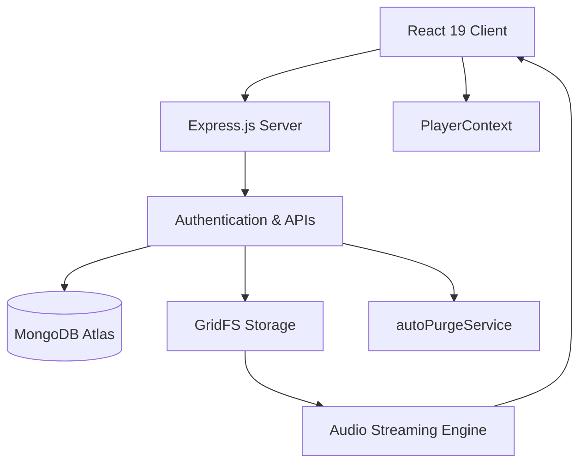

# 🎧 FUZI VERSE

### Your Music. Your Voice. Your Universe.

<p align="center">
  
</p>

<p align="center">
  
  
  
  
</p>

<p align="center">
  <b>🎵 Not Just a Music Platform — A Universe for Independent Creators.</b>
</p>

<p align="center">
  <a href="https://fuzi-verse.onrender.com">🌐 Live Website</a>
</p>

---

## 🌌 About FUZI VERSE

**FUZI VERSE** is a modern music streaming and creator-sharing platform where independent artists can upload original music, discover new talent, stream tracks, and connect with music lovers.

Our mission is to give every creator a platform to share their sound with the world.

## ✨ Key Features

- 🎧 Music streaming with instant seeking.
- 🎤 Creator accounts and music uploads.
- 👤 Secure login and personalized profiles.
- ❤️ Likes, playlists, and artist following.
- 🌐 Trending tracks and artist discovery.
- 🛡️ Five-day moderation grace period with automatic cleanup.
- 🎵 Persistent music player using PlayerContext.
- 📱 Progressive Web App (PWA) support.

## 🎨 UI / UX

- Premium dark theme with neon purple gradients.
- Three.js-powered 3D music visualizers.
- Animated elements and glassmorphism cards.
- Interactive music player.
- Responsive desktop and mobile interface.

## 💻 Technology Stack

| Category | Technologies |
|---|---|
| Frontend | React 19, Tailwind CSS v4, Vite 8 |
| 3D & Audio | Three.js, Web Audio API |
| Icons | Lucide Icons |
| Backend | Node.js (ESM), Express.js |
| Authentication | JWT, Bcrypt.js |
| File Upload | Multer |
| Database | MongoDB Atlas, Mongoose |
| Media Storage | MongoDB GridFS |
| Logging | Morgan |
| Deployment | Render, PWA |
| Dev Tools | Git, GitHub, Cloudflare Tunnel |

## 🏛️ Architecture



### Important Technical Highlights

- **HTTP 206 Streaming:** Byte-range audio delivery for efficient playback and seeking.
- **GridFS:** Chunked audio and media storage in MongoDB.
- **autoPurgeService.js:** Automated content cleanup after a five-day moderation grace period.
- **PlayerContext:** Maintains shared music player state across React components.

## 📁 Project Structure

```text
FUZI-VERSE/
│
├── client/       # React frontend
│   ├── src/
│   ├── public/
│   └── package.json
│
├── server/       # Express backend
│   ├── config/
│   ├── controllers/
│   ├── middleware/
│   ├── models/
│   ├── routes/
│   ├── services/
│   └── server.js
│
├── scripts/
├── start.js
├── README.md
└── FUZI_VERSE_ARCHITECTURE_AND_GUIDE.md
```

## 🚀 Getting Started

### Prerequisites
- Node.js 18+
- MongoDB Atlas account
- Git

### Installation

```bash
git clone https://github.com/YOUR_USERNAME/fuzi-verse.git
cd fuzi-verse
```

Install dependencies:

```bash
cd client
npm install
cd ../server
npm install
cd ..
```

Create `server/.env`:

```env
PORT=5050
MONGO_URI=your_mongodb_connection_string
JWT_SECRET=your_secret_key
```

### Run the Application

**Option 1: Start both services (if configured)**

```bash
node start.js
```

**Option 2: Individual terminals**

Backend:

```bash
cd server
npm run dev
```

Frontend:

```bash
cd client
npm run dev
```

### Local URLs

| Service | URL |
|---|---|
| Frontend | http://localhost:5174 |
| Backend | http://localhost:5050 |

## 🌐 Live Application

<p align="center">
  <a href="https://fuzi-verse.onrender.com">
    
  </a>
</p>

**Live Link:** https://fuzi-verse.onrender.com

FUZI VERSE also supports mobile PWA installation on compatible browsers.

## 🔮 Future Enhancements

- AI-powered music recommendations.
- Artist verification.
- Creator analytics.
- Real-time community interactions.
- Artist monetization.
- Android and iOS applications.

## 📚 Documentation

For complete setup instructions, architecture diagrams, audio streaming lifecycle, API modules, and technical details:

**[FUZI_VERSE_ARCHITECTURE_AND_GUIDE.md](./FUZI_VERSE_ARCHITECTURE_AND_GUIDE.md)**

## 🤝 Contributing

Contributions are welcome! Fork the repository, create a feature branch, make your changes, and submit a Pull Request.

---

<p align="center">
  
</p>

<h2 align="center">🎧 FUZI VERSE</h2>
<h3 align="center">"Create Your Sound. Share Your World."</h3>

<p align="center">💜 Discover Talent • Empower Creators • Celebrate Music</p>
