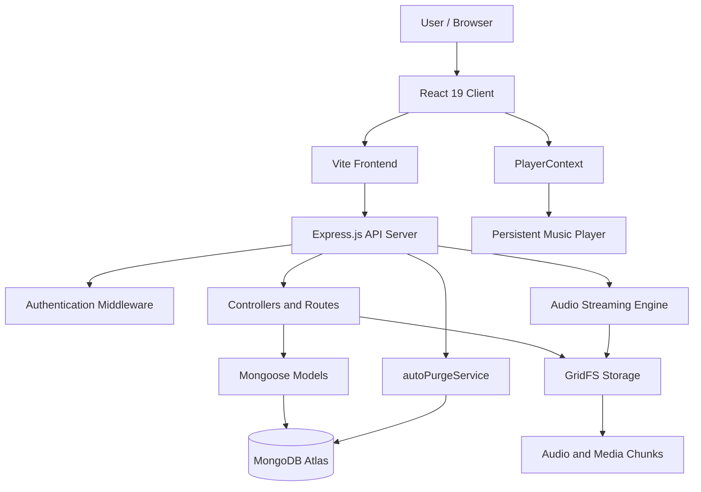
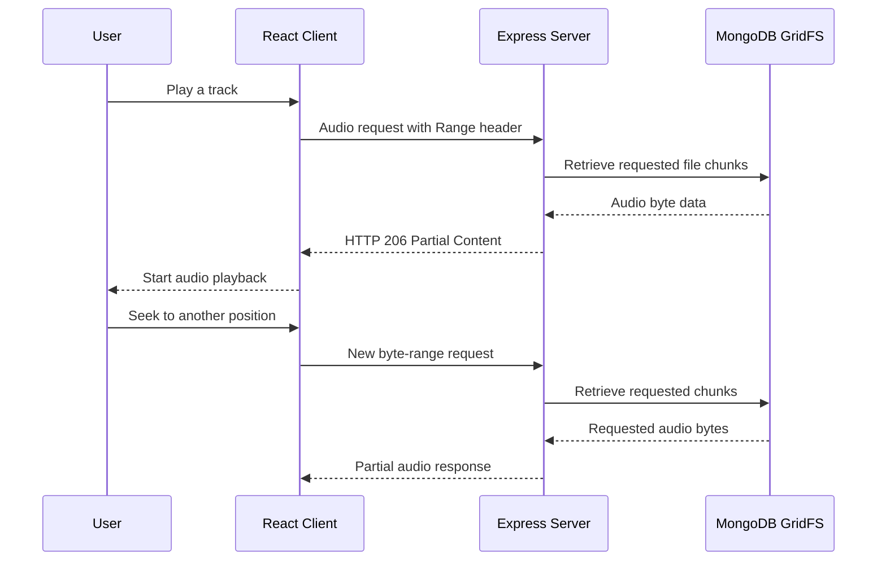

# 🎧 FUZI VERSE

### Your Music. Your Voice. Your Universe.

<p align="center">
  
</p>

<p align="center">
  
  
  
  
  
</p>

<p align="center">
  <b>🎵 Not Just a Music Platform — A Universe for Independent Creators.</b>
</p>

<p align="center">
  <a href="https://fuzi-verse.onrender.com">🌐 Live Application</a>
</p>

---

## 🌌 About FUZI VERSE

**FUZI VERSE** is a modern music streaming and creator-sharing platform designed to give independent musicians, singers, rappers, producers, and emerging artists a place to showcase their talent.

Unlike traditional music streaming platforms that primarily focus on established music catalogs, FUZI VERSE focuses on user-generated music and independent creativity.

Users can create accounts, upload original tracks, discover new artists, stream music, create playlists, and connect with a growing music community.

### 🚀 Our Vision

To build a creative music ecosystem where anyone can share their sound, discover hidden talent, and become part of a global music community.

---

## ✨ Key Features

### 🎧 Music Streaming
- Stream music directly through the platform.
- HTTP byte-range audio streaming for efficient playback.
- Instant seeking without downloading the entire audio file.
- Play, pause, skip, and volume controls.
- Persistent music player state using React Context.
- Explore newly uploaded and trending tracks.

### 🎤 Creator Studio
- Dedicated creator accounts.
- Upload original music tracks.
- Add titles, descriptions, genres, and cover artwork.
- Manage uploaded tracks.
- Edit and delete personal uploads.
- Build an independent artist identity.

### 👤 User Accounts
- Secure registration and login.
- JWT-based authentication.
- Password hashing using Bcrypt.js.
- Personalized profiles.
- Like and save tracks.
- Create and manage playlists.
- Follow favourite artists.

### 🌐 Music Community
- Discover independent artists.
- Explore trending tracks.
- Like and comment on music.
- Share tracks with friends.
- Connect with other music lovers.

### 🛡️ Content Moderation
- Track moderation and reporting workflow.
- Dedicated moderation service.
- Five-day moderation grace period.
- Automatic content cleanup through `autoPurgeService.js`.

---

## 🎨 Premium UI / UX Experience

FUZI VERSE combines modern music-streaming design with immersive visual experiences.

**Design Highlights:**
- Premium dark-themed interface.
- Neon purple and violet gradients.
- Three.js-powered WebGL music visualizers.
- Animated glowing visual elements.
- Interactive music player.
- Glassmorphism-inspired cards.
- Smooth transitions and micro-animations.
- Responsive desktop and mobile layouts.
- Progressive Web App support.

---

## 🎼 Music Categories

- 🎤 Hip-Hop & Rap
- 🎸 Indie & Alternative
- 💕 Romantic
- 💔 Sad & Emotional
- 🎹 Electronic & EDM
- 🎧 Lo-Fi & Chill
- 🎼 Instrumental
- 🔥 Experimental Music
- 🎵 Acoustic & Unplugged

---

## 💻 Technology Stack

### Frontend

| Technology | Purpose |
|---|---|
| React 19 | Component-based UI |
| Tailwind CSS v4 | Styling and responsive design |
| Vite 8 | Frontend development and build tooling |
| Three.js | 3D WebGL music visualizers |
| Lucide Icons | Modern interface icons |
| Web Audio API | Audio processing and visualization |
| React Context API | Persistent player state management |

### Backend

| Technology | Purpose |
|---|---|
| Node.js 18+ | Backend runtime |
| Express.js | REST API development |
| JavaScript ESM | Modern module system |
| Multer | File upload handling |
| JWT | Authentication |
| Bcrypt.js | Password hashing |
| Morgan | HTTP request logging |

### Database & Storage

| Technology | Purpose |
|---|---|
| MongoDB Atlas | Cloud database |
| Mongoose | Database models and queries |
| GridFS | Chunked audio and media storage |

### DevOps & Deployment

| Technology | Purpose |
|---|---|
| Render | Application hosting |
| Render CI/CD | Automated deployment pipeline |
| PWA | Installable web application |
| Cloudflare Tunnel | Secure tunnel for supported development workflows |
| Git & GitHub | Version control and collaboration |

---

## 🏛️ Project Architecture

FUZI VERSE follows a client-server architecture. The React frontend communicates with the Express backend, while MongoDB Atlas manages application data and GridFS stores media files.

### System Architecture Diagram



### 🎵 Audio Streaming Lifecycle

FUZI VERSE uses HTTP byte-range streaming to provide efficient audio playback.



**How it works:**

1. The user selects a music track.
2. The frontend requests the audio from the backend.
3. The browser can send an HTTP `Range` header.
4. The backend retrieves the requested audio chunks from GridFS.
5. The server returns `206 Partial Content` when serving a valid partial range.
6. The browser plays the audio and can request another range when the user seeks.

This avoids requiring the entire audio file to be downloaded before playback or seeking.

### 🛡️ Five-Day Moderation Grace Period

FUZI VERSE includes an automated moderation and cleanup workflow.

- The moderation service manages eligible content.
- A five-day grace period is used before eligible content is automatically purged.
- `autoPurgeService.js` handles the automated cleanup workflow.
- The service works with the backend and database to manage content lifecycle operations.

### 🎧 Persistent PlayerContext

The `PlayerContext` manages shared music player state across React components.

It helps maintain:
- Currently playing track.
- Playback status.
- Current playback position.
- Volume and player controls.
- Track changes and playback state across navigation.

---

## 📁 Project Directory Structure

```text
FUZI-VERSE/
│
├── client/
│   ├── public/
│   │   ├── assets/
│   │   ├── icons/
│   │   └── manifest.json
│   │
│   ├── src/
│   │   ├── components/
│   │   ├── pages/
│   │   ├── context/
│   │   │   └── PlayerContext
│   │   ├── hooks/
│   │   ├── services/
│   │   ├── assets/
│   │   ├── styles/
│   │   ├── App.jsx
│   │   └── main.jsx
│   │
│   ├── index.html
│   ├── vite.config.js
│   └── package.json
│
├── server/
│   ├── config/
│   ├── controllers/
│   ├── middleware/
│   ├── models/
│   ├── routes/
│   ├── services/
│   │   └── autoPurgeService.js
│   ├── uploads/
│   ├── utils/
│   ├── server.js
│   ├── package.json
│   └── .env.example
│
├── scripts/
│   └── startup and utility scripts
│
├── start.js
├── FUZI_VERSE_ARCHITECTURE_AND_GUIDE.md
├── README.md
└── .gitignore
```

*Note: This is the documented project structure. Actual filenames and optional folders may vary with the current repository implementation.*

---

## 🔌 REST API Architecture

The backend exposes REST API groups for the platform's core functionality.

| API Module | Responsibilities |
|---|---|
| Authentication | Registration, login, user authentication |
| Streaming | Audio delivery and HTTP byte-range requests |
| Tracks | Upload, retrieve, update, and delete tracks |
| Playlists | Create and manage playlists |
| Admin | Moderation and administrative operations |

The exact endpoint paths and request parameters are defined in the backend route files.

---

## 🚀 Getting Started

Follow these steps to run FUZI VERSE locally.

### Prerequisites

Install the following tools before starting:

- **Node.js:** Version 18 or higher.
- **MongoDB Atlas:** Cloud database account.
- **Git:** For cloning the repository.
- **Code Editor:** VS Code recommended.
- **Modern Browser:** Chrome, Edge, or Firefox.

### 1. Clone the Repository

```bash
git clone https://github.com/YOUR_USERNAME/fuzi-verse.git
```

### 2. Navigate to the Project

```bash
cd fuzi-verse
```

### 3. Configure Environment Variables

Create a `.env` file inside the `server/` directory.

Example:

```env
PORT=5050
MONGO_URI=your_mongodb_atlas_connection_string
JWT_SECRET=your_secure_jwt_secret
NODE_ENV=development
```

Add any additional environment variables required by your current backend configuration.

**Important:** Never upload your actual `.env` file, database credentials, or JWT secret to GitHub.

### 4. Install Dependencies

Install the frontend dependencies:

```bash
cd client
npm install
```

Install the backend dependencies:

```bash
cd ../server
npm install
```

Return to the project root:

```bash
cd ..
```

### 5. Start FUZI VERSE with One Command

If the root startup script is configured:

```bash
node start.js
```

This launches the configured frontend and backend development processes.

### 6. Alternative: Start Frontend and Backend Separately

**Terminal 1 — Backend**

```bash
cd server
npm install
npm run dev
```

**Terminal 2 — Frontend**

```bash
cd client
npm install
npm run dev
```

### 7. Open the Application

| Service | Local Address |
|---|---|
| React Frontend | http://localhost:5174 |
| Express Backend | http://localhost:5050 |

Make sure the frontend API configuration points to the correct backend URL.

---

## 🌐 Live Application

<p align="center">
  <a href="https://fuzi-verse.onrender.com">
    
  </a>
</p>

**Live Website:** https://fuzi-verse.onrender.com

The production application is hosted on Render.

*Note: Application availability depends on the current deployment and hosting status.*

### 📱 Install FUZI VERSE as a PWA

FUZI VERSE supports Progressive Web App functionality.

On a supported mobile browser:

1. Open the live website.
2. Open the browser menu.
3. Select **Install App** or **Add to Home Screen**, if available.
4. Follow the installation instructions.
5. Launch FUZI VERSE from your home screen.

PWA installation requires the application manifest and service worker to be correctly configured and served.

---

## 🔐 Security & Content Management

- JWT-based authentication.
- Bcrypt.js password hashing.
- Protected routes and authorization.
- File upload validation.
- File type and size restrictions.
- Secure database access.
- GridFS media storage.
- Content moderation workflow.
- Automated eligible-content cleanup.
- Protection against unauthorized track modifications.

---

## 🔮 Future Enhancements

- 🤖 AI-powered music recommendations.
- 🎙️ Artist verification badges.
- 📊 Advanced creator analytics.
- 💬 Real-time artist and listener interactions.
- 🎵 Collaborative playlists.
- 📱 Dedicated Android and iOS applications.
- 💸 Artist monetization and revenue sharing.
- 🏆 Creator rankings and music charts.
- 🎨 Custom artist profile themes.
- 🔔 Personalized notifications.
- 🌍 Global independent music discovery.

---

## 💜 Why FUZI VERSE?

| Traditional Music Platforms | FUZI VERSE |
|---|---|
| Primarily established catalogs | Focus on independent creators |
| Limited emerging artist discovery | Discover new talent |
| Listener-focused experience | Listener and creator ecosystem |
| Established artist exposure | A platform for new voices |
| Music consumption | Music creation, sharing, and discovery |

---

## 🤝 Contributing

We welcome developers, designers, musicians, and creative minds to contribute to FUZI VERSE.

1. Fork the repository.
2. Create a feature branch.
3. Make your changes.
4. Commit your work.
5. Push your branch.
6. Submit a Pull Request.

---

## 📋 Project Information

| Detail | Information |
|---|---|
| Project Name | FUZI VERSE |
| Project Type | Music Streaming & Creator Platform |
| Application Category | Music & Social Community |
| Frontend | React 19 |
| Styling | Tailwind CSS v4 |
| Build Tool | Vite 8 |
| 3D Graphics | Three.js |
| Backend | Node.js + Express.js |
| Database | MongoDB Atlas |
| ODM | Mongoose |
| Media Storage | MongoDB GridFS |
| Authentication | JWT + Bcrypt.js |
| Frontend Port | 5174 |
| Backend Port | 5050 |
| Deployment | Render |
| Application Type | Progressive Web App |

---

## 📚 Additional Documentation

For a deeper technical explanation, setup instructions, architecture details, and API documentation, see:

**[FUZI_VERSE_ARCHITECTURE_AND_GUIDE](./FUZI_VERSE_ARCHITECTURE_AND_GUIDE.md)**

This guide covers:

- Getting Started and environment configuration.
- Complete application architecture.
- Audio streaming lifecycle and HTTP 206 responses.
- Five-day moderation grace period.
- Persistent PlayerContext.
- Technology stack and project structure.
- REST API architecture.

---

## 🌠 Our Philosophy

<p align="center">
  
</p>

<h2 align="center">🎧 FUZI VERSE</h2>

<h3 align="center">"Create Your Sound. Share Your World."</h3>

<p align="center">
  💜 Discover Talent • Empower Creators • Celebrate Music
</p>

<p align="center">
  ⭐ If you love FUZI VERSE, give this repository a star!
</p>
